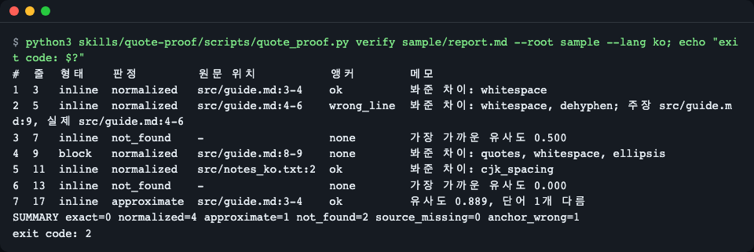
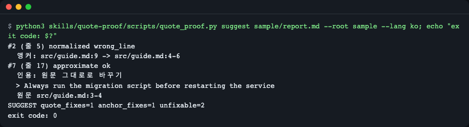
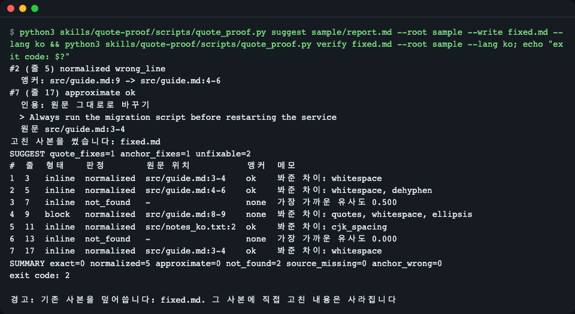
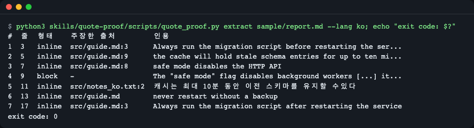
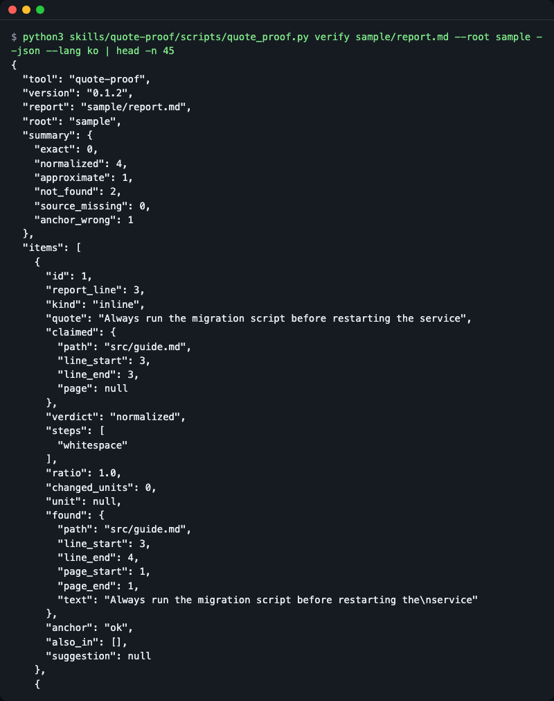
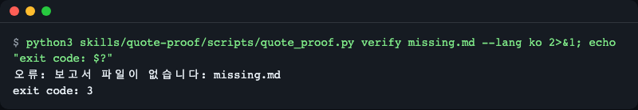
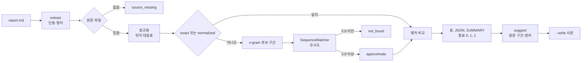

# quote-proof

[English](README.md) | **한국어**

Markdown 보고서의 모든 따옴표 인용을 그 글이 가리킨 로컬 원문 파일과 대조하는 에이전트 스킬입니다. 함께 들어 있는 Python 스크립트(표준 라이브러리만 사용)가 인용마다 실제 원문과 비교해 `exact`, `normalized`, `approximate`, `not_found`, `source_missing` 중 하나로 판정하고, `path:line`·각주·`#L` 출처 표기가 맞는 위치를 가리키는지 확인한 뒤, 원문 그대로의 문장과 올바른 출처 표기를 제안합니다. Claude Code와 Agent Skills 표준을 읽는 다른 에이전트에서 쓸 수 있습니다.


*동봉된 샘플 보고서에 `verify`를 실행한 화면: 인용마다 한 줄, `SUMMARY` 줄, 그리고 원문에 없는 인용이 둘 있어 종료 코드 2.*

## 무엇을 하나

- **인용과 출처를 찾습니다.** 인라인 인용(`"..."`, `“...”`, `「...」`), 블록 인용, 그리고 뒤따르는 `(path:12)`, `(path:12-15)`, `(path:p.3)`, `[text](path#L12-L20)`, `[^1]` 각주 표기.
- **모델의 기억이 아니라 파일과 비교합니다.** 줄바꿈, 줄끝 하이픈, 둥근 따옴표, 한국어 띄어쓰기 차이는 접어서 비교하고 그 기록을 남깁니다. 다른 단어는 절대 접지 않습니다.
- **위치는 따로 판정합니다.** 앵커 열은 `ok`, `wrong_line`(파일은 맞는데 줄이 틀림), `wrong_file`(문장이 다른 파일에 있음) 중 하나입니다.
- **고칠 방법을 제안합니다.** `suggest`는 원문 그대로의 구간과 올바른 앵커를 보여 주고, `--write`는 교정 사본을 저장합니다. 보고서 원본은 덮어쓰지 않습니다.
- **영어·한국어로 출력합니다.** 판정 단어, JSON 키, `SUMMARY` 줄은 두 언어에서 같습니다.

녹취록에서 따옴표 문장을 Ctrl+F로 찾아 대조하는 교열 담당자를 떠올려 보세요. 인쇄상의 차이(어디서 줄이 바뀌었나, 어떤 따옴표인가)는 봐주지만 단어가 바뀌면 멈춥니다. 스크립트도 같은 일을 하고, 무엇을 봐줬는지 적어 둡니다.

## 왜 필요한가

에이전트는 인용된 문서에 없는 문장에 따옴표를 붙이거나, "원문 그대로"라면서 단어 하나를 바꾸곤 합니다([anthropics/claude-code#21065](https://github.com/anthropics/claude-code/issues/21065), [#57861](https://github.com/anthropics/claude-code/issues/57861), 2026-11-14 확인). 모델은 자기 글을 읽어서는 베낀 인용과 그럴듯한 바꿔 쓰기를 구분하지 못하고 줄 번호도 잘못 셉니다. `grep`도 도움이 안 됩니다. 두 줄에 걸쳐 줄바꿈됐거나 하이픈으로 끊긴 정상 인용은 한 문자열로는 찾아지지 않기 때문입니다.

## 설치

Python 3.10 이상이 필요하고 `pip install`할 것은 없습니다. 스크립트는 파일만 읽습니다. 네트워크도 API 키도 쓰지 않습니다.

**Claude Code** (Claude Code 2.1.322 에서 확인)

```
/plugin marketplace add LeeGyeongPil/quote-proof
/plugin install quote-proof@quote-proof-skill
```

**다른 에이전트(Agent Skills 표준)**: `skills/quote-proof` 폴더를 에이전트의 스킬 폴더(예: 프로젝트의 `.agents/skills/`)로 복사합니다.

**에이전트 없이**: 레포를 clone해서 스크립트를 바로 실행합니다.

```
git clone https://github.com/LeeGyeongPil/quote-proof
cd quote-proof
python3 skills/quote-proof/scripts/quote_proof.py --help
```

## 빠르게 시작하기

`sample/`에 인용 7개짜리 작은 보고서와 원문 파일 둘이 들어 있습니다. 레포 루트에서 실행하세요.

```
python3 skills/quote-proof/scripts/quote_proof.py verify sample/report.md --root sample --lang ko; echo "exit code: $?"
```

```
#  줄  형태    판정         원문 위치           앵커        메모
1  3   inline  normalized   src/guide.md:3-4    ok          봐준 차이: whitespace
2  5   inline  normalized   src/guide.md:4-6    wrong_line  봐준 차이: whitespace, dehyphen; 주장 src/guide.md:9, 실제 src/guide.md:4-6
3  7   inline  not_found    -                   none        가장 가까운 유사도 0.500
4  9   block   normalized   src/guide.md:8-9    none        봐준 차이: quotes, whitespace, ellipsis
5  11  inline  normalized   src/notes_ko.txt:2  ok          봐준 차이: cjk_spacing
6  13  inline  not_found    -                   none        가장 가까운 유사도 0.000
7  17  inline  approximate  src/guide.md:3-4    ok          유사도 0.889, 단어 1개 다름
SUMMARY exact=0 normalized=4 approximate=1 not_found=2 source_missing=0 anchor_wrong=1
exit code: 2
```

읽는 법:

- 1행은 원문과 같은 문장이고 두 줄로 줄바꿈된 것뿐입니다(`whitespace`).
- 2행은 내용은 맞지만 `src/guide.md:9`를 가리킵니다. 실제 위치는 4-6줄입니다(`wrong_line`). 원문은 "minutes"를 `min-` / `utes`로 끊어 놓았습니다(`dehyphen`).
- 3행과 6행은 어떤 원문에도 없습니다(`not_found`). 3행은 "safe mode disables the HTTP API"라고 하지만 가이드는 반대로 말합니다.
- 7행은 단어 하나가 다릅니다. 보고서는 `after`, 원문은 `before`입니다(`approximate`, 9단어 중 1개 다름). 이것은 통과가 아닙니다.
- 종료 코드 2는 `not_found` 또는 `source_missing`이 하나 이상 있다는 뜻입니다.

이제 고칠 방법을 물어봅니다.

```
python3 skills/quote-proof/scripts/quote_proof.py suggest sample/report.md --root sample --lang ko; echo "exit code: $?"
```

```
#2 (줄 5) normalized wrong_line
  앵커: src/guide.md:9 -> src/guide.md:4-6
#7 (줄 17) approximate ok
  인용: 원문 그대로로 바꾸기
  > Always run the migration script before restarting the service
  원문 src/guide.md:3-4
SUGGEST quote_fixes=1 anchor_fixes=1 unfixable=2
exit code: 0
```


*`suggest`는 올바른 앵커와 원문 그대로의 문장을 보여 줍니다. `not_found` 인용 둘은 `unfixable`로 나옵니다. 말을 바꿔 쓸지 지울지는 사람(또는 에이전트)이 정해야 합니다.*

교정 사본을 쓰고 다시 확인합니다.

```
python3 skills/quote-proof/scripts/quote_proof.py suggest sample/report.md --root sample --write fixed.md --lang ko && python3 skills/quote-proof/scripts/quote_proof.py verify fixed.md --root sample --lang ko; echo "exit code: $?"
```

```
#2 (줄 5) normalized wrong_line
  앵커: src/guide.md:9 -> src/guide.md:4-6
#7 (줄 17) approximate ok
  인용: 원문 그대로로 바꾸기
  > Always run the migration script before restarting the service
  원문 src/guide.md:3-4
고친 사본을 썼습니다: fixed.md
SUGGEST quote_fixes=1 anchor_fixes=1 unfixable=2
#  줄  형태    판정        원문 위치           앵커  메모
1  3   inline  normalized  src/guide.md:3-4    ok    봐준 차이: whitespace
2  5   inline  normalized  src/guide.md:4-6    ok    봐준 차이: whitespace, dehyphen
3  7   inline  not_found   -                   none  가장 가까운 유사도 0.500
4  9   block   normalized  src/guide.md:8-9    none  봐준 차이: quotes, whitespace, ellipsis
5  11  inline  normalized  src/notes_ko.txt:2  ok    봐준 차이: cjk_spacing
6  13  inline  not_found   -                   none  가장 가까운 유사도 0.000
7  17  inline  normalized  src/guide.md:3-4    ok    봐준 차이: whitespace
SUMMARY exact=0 normalized=5 approximate=0 not_found=2 source_missing=0 anchor_wrong=0
exit code: 2
```


*자동 교정 뒤에는 지어낸 인용 둘만 남습니다. 따옴표 없이 바꿔 쓰거나 지워야 합니다.*

`fixed.md`는 임시 파일입니다(`.gitignore`에 들어 있음). 다 쓰면 지우세요.

확인·교정·재확인을 명령 하나로 할 수도 있습니다. `verify --fix`는 보고서 옆에 사본 `REPORT.fixed.md`를 쓰고, 손으로 고칠 것을 나열한 뒤 사본을 다시 확인합니다. 마지막 `SUMMARY` 줄과 종료 코드는 사본 기준입니다. `REPORT.fixed.md`가 이미 있으면 덮어쓰며(stderr 경고가 알려 줍니다) 그 사본에 직접 고친 내용은 사라집니다. 둘 다 남기려면 `--write OTHER.md`를 쓰세요.

```
python3 skills/quote-proof/scripts/quote_proof.py verify sample/report.md --root sample --lang ko --fix; echo "exit code: $?"
```

```
#  줄  형태    판정         원문 위치           앵커        메모
1  3   inline  normalized   src/guide.md:3-4    ok          봐준 차이: whitespace
2  5   inline  normalized   src/guide.md:4-6    wrong_line  봐준 차이: whitespace, dehyphen; 주장 src/guide.md:9, 실제 src/guide.md:4-6
3  7   inline  not_found    -                   none        가장 가까운 유사도 0.500
4  9   block   normalized   src/guide.md:8-9    none        봐준 차이: quotes, whitespace, ellipsis
5  11  inline  normalized   src/notes_ko.txt:2  ok          봐준 차이: cjk_spacing
6  13  inline  not_found    -                   none        가장 가까운 유사도 0.000
7  17  inline  approximate  src/guide.md:3-4    ok          유사도 0.889, 단어 1개 다름
SUMMARY exact=0 normalized=4 approximate=1 not_found=2 source_missing=0 anchor_wrong=1

#2 (줄 5) normalized wrong_line
  앵커: src/guide.md:9 -> src/guide.md:4-6
#7 (줄 17) approximate ok
  인용: 원문 그대로로 바꾸기
  > Always run the migration script before restarting the service
  원문 src/guide.md:3-4
고친 사본을 썼습니다: sample/report.fixed.md
SUGGEST quote_fixes=1 anchor_fixes=1 unfixable=2
sample/report.fixed.md 에서 손으로 고칠 것:
  #3 (줄 7) not_found: 따옴표 없는 바꿔 쓰기로 고치거나 지우세요. 문구를 추측하지 마세요
  #6 (줄 13) not_found: 따옴표 없는 바꿔 쓰기로 고치거나 지우세요. 문구를 추측하지 마세요

고친 사본 sample/report.fixed.md 다시 확인:
#  줄  형태    판정        원문 위치           앵커  메모
1  3   inline  normalized  src/guide.md:3-4    ok    봐준 차이: whitespace
2  5   inline  normalized  src/guide.md:4-6    ok    봐준 차이: whitespace, dehyphen
3  7   inline  not_found   -                   none  가장 가까운 유사도 0.500
4  9   block   normalized  src/guide.md:8-9    none  봐준 차이: quotes, whitespace, ellipsis
5  11  inline  normalized  src/notes_ko.txt:2  ok    봐준 차이: cjk_spacing
6  13  inline  not_found   -                   none  가장 가까운 유사도 0.000
7  17  inline  normalized  src/guide.md:3-4    ok    봐준 차이: whitespace
SUMMARY exact=0 normalized=5 approximate=0 not_found=2 source_missing=0 anchor_wrong=0
exit code: 2
```

`verify --write FILE`은 사본 이름만 바꿔 같은 일을 합니다. 보고서 경로를 빼면 `verify`와 `suggest`는 `--root` 아래에서 출처를 단 인용이 있는 유일한 Markdown 파일을 씁니다. 그런 파일이 없거나 여러 개면 종료 코드 3으로 멈추고 무엇을 넘겨야 하는지 알려 줍니다. `*.fixed.md` 사본은 `.gitignore`에 들어 있습니다.

## 에이전트에서 쓰기

`skills/quote-proof/SKILL.md`는 확인용 명령 하나(`verify`)와 확인·교정용 명령 하나(`verify --fix`)를 주고, 폴더를 먼저 둘러보거나 도움말을 읽지 말라고 알려 줍니다. 에이전트는 스크립트가 나열한 `not_found` 인용만 따옴표 없이 바꿔 쓰거나 지우고, 사본에 `verify`를 한 번 돌린 뒤 `SUMMARY` 줄과 바꾼 내용을 알려 줍니다. 판정은 전부 스크립트가 하고 모델은 고쳐 쓰기만 합니다.

스킬을 부르는 요청 예:

- "보고서에 있는 인용문이 원문 파일에 실제로 있는지 확인해 줘."
- "요약 문서의 따옴표 인용과 파일:줄 출처가 맞는지 검증하고 틀린 건 고쳐 줘."
- "이 답변이 docs 폴더에서 인용했다는 문장들, 지어낸 거 없는지 원문이랑 대조해 봐."

(영어 요청도 됩니다. 예: "Check that every quote in report.md actually appears in the docs it cites.")

## 지원하는 입력 형식

**보고서(Markdown) 안의 인용과 출처 표기**

| 형식 | 예 |
|---|---|
| 줄 번호가 있는 인라인 인용 | `"..." (src/guide.md:12)` |
| 줄 범위 | `"..." (src/guide.md:12-15)` |
| 폼 피드로 나뉜 텍스트의 쪽 | `"..." (paper.txt:p.3)` |
| 파일만 | `"..." (src/guide.md)` |
| 줄이 있는 Markdown 링크 | `"..." [guide](src/guide.md#L12-L20)` |
| 각주 | `"..."[^1]` 와 `[^1]: src/guide.md:12-15` |
| 블록 인용 | 연속된 `>` 줄, 인용 하나로 취급 |
| 출처 표기 없음 | `--root` 아래 텍스트 파일을 검색(`--source FILE`로 범위 제한) |

인식하는 따옴표: `"..."`, `“...”`, `「...」`, `『...』`. 홑따옴표, 코드 스팬, 코드 펜스는 무시합니다. `--min-words`(기본 4단어, 한국어·일본어·중국어는 글자 수 2배)보다 짧은 인용은 강조로 보고 건너뜁니다. 자세한 내용: [`references/anchors.md`](skills/quote-proof/references/anchors.md)(영어).

**원문 파일**

| 형식 | 읽는 방법 |
|---|---|
| `.md`, `.txt`, `.rst`, 코드, 설정 파일 | UTF-8 텍스트(BOM 허용) |
| `.html`, `.htm` | 텍스트로 바꿔 읽음, 보고되는 줄 번호는 HTML 파일의 줄 |
| 폼 피드(`\f`)가 있는 텍스트 | 쪽으로 나뉘어 `p.N` 표기를 쓸 수 있음 |
| PDF, Word, 이미지, 그 밖의 바이너리 | 읽지 않음: 먼저 텍스트로 바꿀 것 |
| `http://`, `https://` 링크 | 원문이 아님: 아무것도 내려받지 않음 |

5MB가 넘는 파일은 경고(`원문이 너무 커서(5MB 초과) 건너뛰었습니다: <경로>. 더 작은 파일로 나누거나 더 작은 원문을 인용하세요`)와 함께 건너뛰고, `--root` 밖은 읽지 않습니다.

**입력 만드는 법**

- *보고서*: 에이전트에게 평소처럼 쓰게 하되 위 형식 중 하나로 출처를 달라고 합니다. 예: "인용마다 뒤에 `(docs/setup.md:12-15)` 처럼 파일과 줄을 붙여 줘." 사람이 쓴 글도 같은 방식으로 검사됩니다.
- *원문*: 텍스트 파일로 한 폴더 아래에 두고 그 폴더를 `--root`로 줍니다. PDF는 먼저 텍스트로 뽑고(예: `pdftotext paper.pdf paper.txt`, 스크립트가 호출하지는 않습니다) 쪽은 `paper.txt:p.3`으로 적습니다.
- *판정 전에 찾은 것 확인*: `extract`는 인용과 주장된 출처를 나열하며 원문 파일은 읽지 않습니다.

```
python3 skills/quote-proof/scripts/quote_proof.py extract sample/report.md --lang ko
```

```
#  줄  형태    주장한 출처         인용
1  3   inline  src/guide.md:3      Always run the migration script before restarting the ser...
2  5   inline  src/guide.md:9      the cache will hold stale schema entries for up to ten mi...
3  7   inline  src/guide.md:8      safe mode disables the HTTP API
4  9   block   -                   The "safe mode" flag disables background workers [...] it...
5  11  inline  src/notes_ko.txt:2  캐시는 최대 10분 동안 이전 스키마를 유지할 수있다
6  13  inline  src/guide.md        never restart without a backup
7  17  inline  src/guide.md:3      Always run the migration script after restarting the service
```


*`extract`는 파일을 비교하기 전에 스크립트가 보고서에서 무엇을 읽어 냈는지 보여 줍니다.*

## 판정과 종료 코드

| 판정 | 뜻 | 고치는 법 |
|---|---|---|
| `exact` | 원문의 글자 그대로의 부분 문자열 | 없음 |
| `normalized` | 인쇄상의 차이를 접으면 같은 단어; 봐준 단계가 적힘 | 없음 |
| `approximate` | 가장 가까운 구간의 유사도가 `--min-ratio`(기본 0.8) 이상이지만 단어가 다름 | `suggest`가 원문 문장을 줌 |
| `not_found` | 충분히 가까운 것이 없음 | 따옴표 없이 바꿔 쓰거나 삭제 |
| `source_missing` | 인용한 파일이 없거나 읽을 수 없거나 너무 크거나 `--root` 밖 | 경로 고치기 |

| 종료 코드 | 언제 |
|---|---|
| 0 | 모든 인용이 `exact` 또는 `normalized`이고 앵커가 맞음(인용이 없어도 0) |
| 1 | `approximate` 인용이나 틀린 앵커가 있고 `not_found`·`source_missing`은 없음 |
| 2 | `not_found` 또는 `source_missing`이 하나 이상 |
| 3 | 사용법 또는 입력 오류 |

`approximate`는 일부러 통과로 치지 않습니다. 뜻을 뒤집는 단어 하나일 수 있기 때문입니다.

## 무엇을 봐주고 무엇을 안 봐주나

| 단계 | 접는 것 |
|---|---|
| `nfkc` | 합자, 전각 문자 |
| `quotes` | 둥근 따옴표·아래 따옴표를 곧은 따옴표로 |
| `dashes` | en 대시, em 대시, 마이너스 기호를 하이픈으로 |
| `whitespace` | 연속 공백, 탭, 줄바꿈, 줄바꿈 없는 공백 |
| `dehyphen` | 줄끝 하이픈으로 끊긴 단어(이은 형태와 하이픈 유지 형태를 모두 시도), 소프트 하이픈 |
| `case` | 대소문자 |
| `md_markup` | 원문의 `**`, 백틱, `~~`, `__`, `>` 표시 |
| `ellipsis` | 조각 사이의 `[...]`, `…` (조각이 순서대로 나와야 함) |
| `cjk_spacing` | 한국어·일본어·중국어 글자 옆의 공백 |

일치한 구간 안에서 실제로 필요했던 단계만 적습니다. 단어는 절대 바꾸지 않습니다. 다른 단어, 어미, 동의어는 접히지 않습니다. 자세한 내용: [`references/verdicts.md`](skills/quote-proof/references/verdicts.md)(영어).

## JSON 출력

`--json`은 프로그램과 에이전트용으로 키가 고정된 출력을 냅니다. 샘플의 앞 45줄:

```
python3 skills/quote-proof/scripts/quote_proof.py verify sample/report.md --root sample --json --lang ko | head -n 45
```

```json
{
  "tool": "quote-proof",
  "version": "0.1.3",
  "report": "sample/report.md",
  "root": "sample",
  "summary": {
    "exact": 0,
    "normalized": 4,
    "approximate": 1,
    "not_found": 2,
    "source_missing": 0,
    "anchor_wrong": 1
  },
  "items": [
    {
      "id": 1,
      "report_line": 3,
      "kind": "inline",
      "quote": "Always run the migration script before restarting the service",
      "claimed": {
        "path": "src/guide.md",
        "line_start": 3,
        "line_end": 3,
        "page": null
      },
      "verdict": "normalized",
      "steps": [
        "whitespace"
      ],
      "ratio": 1.0,
      "changed_units": 0,
      "unit": null,
      "found": {
        "path": "src/guide.md",
        "line_start": 3,
        "line_end": 4,
        "page_start": 1,
        "page_end": 1,
        "text": "Always run the migration script before restarting the\nservice"
      },
      "anchor": "ok",
      "also_in": [],
      "suggestion": null
    },
    {
```


*`report_line`(보고서 안의 위치)과 `found.line_start`(원문 안의 위치)는 서로 다른 키입니다.*

## 언어

출력 언어는 `--lang en|ko`, `QUOTE_PROOF_LANG` 환경 변수, `LC_ALL`·`LC_MESSAGES`·`LANG`(비어 있지 않은 첫 값, `ko`로 시작하면 한국어) 순으로 정합니다. 그 밖은 영어입니다. 오류 메시지도 번역됩니다.

```
python3 skills/quote-proof/scripts/quote_proof.py verify missing.md --lang ko; echo "exit code: $?"
```

```
오류: 보고서 파일이 없습니다: missing.md
exit code: 3
```


*입력 오류는 3으로 끝나서 판정 코드와 헷갈리지 않습니다.*

## 검증된 동작

<!-- skill-eval:start -->
| 확인 | 결과 |
|---|---|
| 필요할 때 불림 | 12/12 |
| 필요 없을 때 안 불림 | 10/10 |
| 스킬로 푼 작업 | 7/7 |
| 스킬 없이 푼 작업(기준선) | 0/7 |
| 평균 점수 차이(Δ) | +0.67 |
| 가짜 스크립트를 잡아낸 비율 | 7/7 |
| Codex CLI | 작업 7/7 통과 · 확인됨 |

Claude Code 2.1.322 · sonnet · 케이스마다 3회 · 2026-11-14 측정 · codex-cli 0.154.0
<!-- skill-eval:end -->

## 동작 원리



1. 스크립트가 인용과 그것이 가리킨 출처를 뽑습니다. 2. 그 파일을 읽고(출처 표기가 없으면 `--root` 아래를 검색) 양쪽을 정규화하되 모든 글자가 어디서 왔는지 기억합니다. 3. 정확히 일치, 다음으로 정규화 일치를 시도하고, 둘 다 안 되면 단어 n-gram으로 후보를 좁혀 `difflib`(`autojunk=False`)로 점수를 냅니다. 4. 찾은 줄을 주장된 앵커와 비교합니다. 5. 표와 종료 코드를 출력하고, `suggest`가 결과를 교체 문구로 바꿉니다.

스크립트는 보고서와 원문 파일만 읽고, `--write`나 `--out`으로 요청한 것만 씁니다. 보고서를 덮어쓰지 않고, `--root` 밖을 읽지 않으며, 네트워크를 쓰지 않습니다.

## 언제 쓰나

- 잘 맞는 경우: 에이전트가 문서 폴더, 릴리스 노트, 설계 메모를 요약했고 공유하기 전에 어떤 "인용"이 진짜인지 알고 싶을 때. 또는 `path:line` 출처가 달린 사람이 쓴 글을 교열할 때.
- 하지 않는 일: 원문이 주장을 *뒷받침하는지* 판단, 참고문헌 서식(APA, BibTeX), 링크가 살아 있는지 검사, 웹 페이지 가져오기. 그런 일은 다른 도구의 몫입니다. 예를 들어 한 원문에서 얼마나 베꼈는지 재는 [verbatimeter](https://pypi.org/project/verbatimeter/), 학술 원고용 [citefact](https://pypi.org/project/citefact/), 답변을 생성하는 동안 인용을 만드는 Anthropic [Citations API](https://docs.anthropic.com/en/docs/build-with-claude/citations)가 있습니다.
- 한계: 단어 단위 비교는 문장부호를 보지 않으므로 쉼표만 빠진 인용은 유사도 1.0, 바뀐 단어 0개의 `approximate`가 되며 `normalized`로 통과하지 않습니다. `wrong_file`은 다른 파일에서 `exact`나 `normalized`로 찾은 경우에만 알 수 있습니다.

## 개발

```
uv sync && uv run pytest -q
```

`evals/`에 평가 세트가 있습니다: 스킬을 불러야 하는 요청, 불러서는 안 되는 비슷한 요청, 텍스트만으로 된 픽스처와 정확한 값 채점기가 있는 작업 케이스.

## 라이선스

MIT
