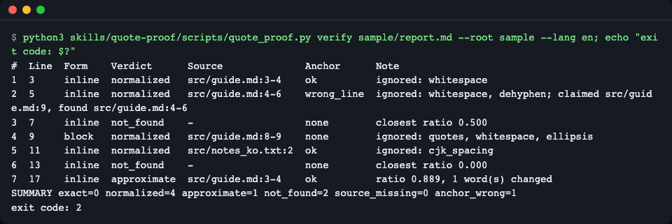
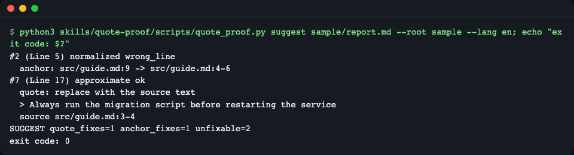
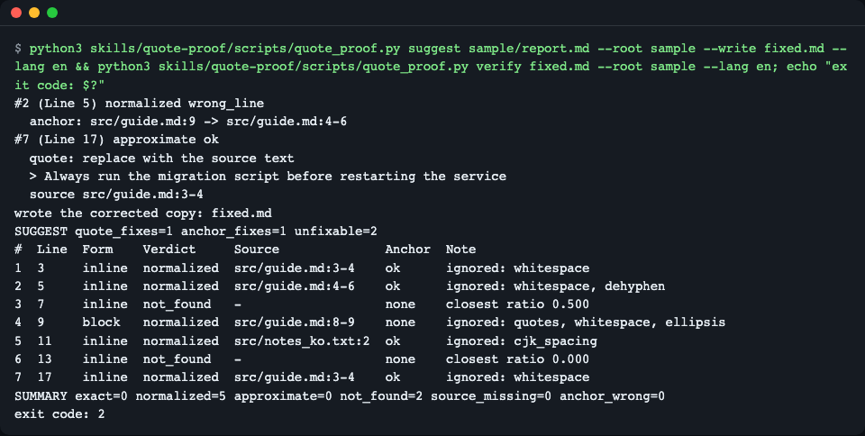
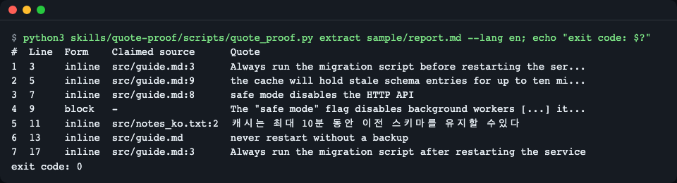
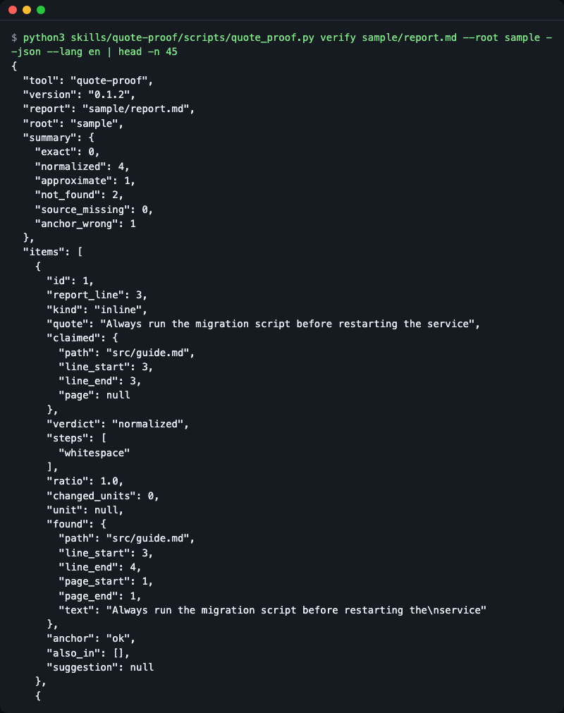
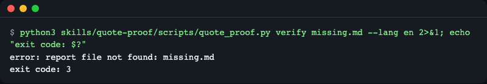
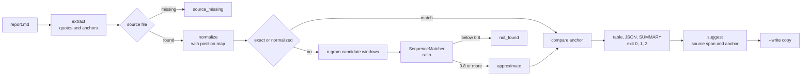

# quote-proof

**English** | [한국어](README.ko.md)

An agent skill that checks every quoted passage in a Markdown report against the local source files it cites. A bundled Python script (standard library only) compares each quote with the real text, labels it `exact`, `normalized`, `approximate`, `not_found` or `source_missing`, checks that the `path:line`, footnote or `#L` anchor points at the right place, and suggests the exact source text and corrected anchor. It works with Claude Code and with other agents that read the Agent Skills standard.


*`verify` on the bundled sample report: one row per quote, a `SUMMARY` line, and exit code 2 because two quotes are not in the sources.*

## What it does

- **Finds quotes and their sources.** Inline quotes (`"..."`, `“...”`, `「...」`), blockquotes, and the `(path:12)`, `(path:12-15)`, `(path:p.3)`, `[text](path#L12-L20)` and `[^1]` footnote anchors that follow them.
- **Compares them with the files, not with the model's memory.** Line breaks, hyphenated line ends, curly quotes and Korean spacing are folded away and recorded; a different word is never folded away.
- **Judges the position separately.** The anchor column says `ok`, `wrong_line` (right file, wrong lines) or `wrong_file` (the sentence is in another file).
- **Suggests the fix.** `suggest` prints the exact source passage and the corrected anchor, and `--write` saves a corrected copy. It never overwrites the report.
- **Speaks English and Korean.** Verdict words, JSON keys and the `SUMMARY` line are the same in both languages.

Think of a copy editor who checks a quoted sentence against the transcript with Ctrl+F: she ignores differences in printing (where the line wrapped, which kind of quotation mark) but stops at a changed word. The script does the same, and writes down which differences it ignored.

## Why

Agents sometimes put sentences in quotation marks that the cited documents do not contain, or change one word of a "verbatim" quote ([anthropics/claude-code#21065](https://github.com/anthropics/claude-code/issues/21065), [#57861](https://github.com/anthropics/claude-code/issues/57861), checked 2026-11-14). A model reading its own text cannot tell a copied quote from a plausible paraphrase, and it miscounts lines. `grep` is no help either: a correct quote that wrapped over two lines, or was split with a hyphen, does not match as a single string.

## Install

Requires Python 3.10 or newer; nothing to `pip install`. The script reads files only; it uses no network and no API key.

**Claude Code** (checked with Claude Code 2.1.322)

```
/plugin marketplace add LeeGyeongPil/quote-proof
/plugin install quote-proof@quote-proof-skill
```

**Other agents (Agent Skills standard)**: copy `skills/quote-proof` into the agent's skills folder (for example `.agents/skills/` in a project).

**Without an agent**: clone the repo and run the script directly.

```
git clone https://github.com/LeeGyeongPil/quote-proof
cd quote-proof
python3 skills/quote-proof/scripts/quote_proof.py --help
```

## Quick start

The repo ships a small report with seven quotes and two source files in `sample/`. Run this from the repo root:

```
python3 skills/quote-proof/scripts/quote_proof.py verify sample/report.md --root sample --lang en; echo "exit code: $?"
```

```
#  Line  Form    Verdict      Source              Anchor      Note
1  3     inline  normalized   src/guide.md:3-4    ok          ignored: whitespace
2  5     inline  normalized   src/guide.md:4-6    wrong_line  ignored: whitespace, dehyphen; claimed src/guide.md:9, found src/guide.md:4-6
3  7     inline  not_found    -                   none        closest ratio 0.500
4  9     block   normalized   src/guide.md:8-9    none        ignored: quotes, whitespace, ellipsis
5  11    inline  normalized   src/notes_ko.txt:2  ok          ignored: cjk_spacing
6  13    inline  not_found    -                   none        closest ratio 0.000
7  17    inline  approximate  src/guide.md:3-4    ok          ratio 0.889, 1 word(s) changed
SUMMARY exact=0 normalized=4 approximate=1 not_found=2 source_missing=0 anchor_wrong=1
exit code: 2
```

How to read it:

- Row 1 is the same sentence as the source, only wrapped over two lines (`whitespace`).
- Row 2 is correct but cites `src/guide.md:9`; the passage is at lines 4-6 (`wrong_line`). The source splits "minutes" as `min-` / `utes` (`dehyphen`).
- Rows 3 and 6 are not in any source (`not_found`). Row 3 claims "safe mode disables the HTTP API", but the guide says the opposite.
- Row 7 differs by one word: the report says `after`, the source says `before` (`approximate`, 1 of 9 words changed). This is never a pass.
- Exit code 2 means at least one quote is `not_found` or `source_missing`.

Now ask for the fixes:

```
python3 skills/quote-proof/scripts/quote_proof.py suggest sample/report.md --root sample --lang en; echo "exit code: $?"
```

```
#2 (Line 5) normalized wrong_line
  anchor: src/guide.md:9 -> src/guide.md:4-6
#7 (Line 17) approximate ok
  quote: replace with the source text
  > Always run the migration script before restarting the service
  source src/guide.md:3-4
SUGGEST quote_fixes=1 anchor_fixes=1 unfixable=2
exit code: 0
```


*`suggest` shows the right anchor and the exact source text. The two `not_found` quotes are listed as `unfixable`: only a person (or the agent) can decide to reword or remove them.*

Write the corrected copy and check it again:

```
python3 skills/quote-proof/scripts/quote_proof.py suggest sample/report.md --root sample --write fixed.md --lang en && python3 skills/quote-proof/scripts/quote_proof.py verify fixed.md --root sample --lang en; echo "exit code: $?"
```

```
#2 (Line 5) normalized wrong_line
  anchor: src/guide.md:9 -> src/guide.md:4-6
#7 (Line 17) approximate ok
  quote: replace with the source text
  > Always run the migration script before restarting the service
  source src/guide.md:3-4
wrote the corrected copy: fixed.md
SUGGEST quote_fixes=1 anchor_fixes=1 unfixable=2
#  Line  Form    Verdict     Source              Anchor  Note
1  3     inline  normalized  src/guide.md:3-4    ok      ignored: whitespace
2  5     inline  normalized  src/guide.md:4-6    ok      ignored: whitespace, dehyphen
3  7     inline  not_found   -                   none    closest ratio 0.500
4  9     block   normalized  src/guide.md:8-9    none    ignored: quotes, whitespace, ellipsis
5  11    inline  normalized  src/notes_ko.txt:2  ok      ignored: cjk_spacing
6  13    inline  not_found   -                   none    closest ratio 0.000
7  17    inline  normalized  src/guide.md:3-4    ok      ignored: whitespace
SUMMARY exact=0 normalized=5 approximate=0 not_found=2 source_missing=0 anchor_wrong=0
exit code: 2
```


*After the automatic fixes only the two invented quotes remain; they have to be reworded without quotation marks or removed.*

`fixed.md` is a scratch file (it is in `.gitignore`); delete it when you are done.

The same check, fix and re-check in one command: `verify --fix` writes the copy `REPORT.fixed.md` next to the report, lists what is left to fix by hand and re-checks the copy. The last `SUMMARY` line and the exit code are the copy's. If `REPORT.fixed.md` already exists it is overwritten (a warning on stderr says so), so hand edits made to it are lost; use `--write OTHER.md` to keep both.

```
python3 skills/quote-proof/scripts/quote_proof.py verify sample/report.md --root sample --lang en --fix; echo "exit code: $?"
```

```
#  Line  Form    Verdict      Source              Anchor      Note
1  3     inline  normalized   src/guide.md:3-4    ok          ignored: whitespace
2  5     inline  normalized   src/guide.md:4-6    wrong_line  ignored: whitespace, dehyphen; claimed src/guide.md:9, found src/guide.md:4-6
3  7     inline  not_found    -                   none        closest ratio 0.500
4  9     block   normalized   src/guide.md:8-9    none        ignored: quotes, whitespace, ellipsis
5  11    inline  normalized   src/notes_ko.txt:2  ok          ignored: cjk_spacing
6  13    inline  not_found    -                   none        closest ratio 0.000
7  17    inline  approximate  src/guide.md:3-4    ok          ratio 0.889, 1 word(s) changed
SUMMARY exact=0 normalized=4 approximate=1 not_found=2 source_missing=0 anchor_wrong=1

#2 (Line 5) normalized wrong_line
  anchor: src/guide.md:9 -> src/guide.md:4-6
#7 (Line 17) approximate ok
  quote: replace with the source text
  > Always run the migration script before restarting the service
  source src/guide.md:3-4
wrote the corrected copy: sample/report.fixed.md
SUGGEST quote_fixes=1 anchor_fixes=1 unfixable=2
left to fix by hand in sample/report.fixed.md:
  #3 (Line 7) not_found: rewrite it as a paraphrase without quotation marks, or remove it; do not guess the wording
  #6 (Line 13) not_found: rewrite it as a paraphrase without quotation marks, or remove it; do not guess the wording

re-check of the corrected copy sample/report.fixed.md:
#  Line  Form    Verdict     Source              Anchor  Note
1  3     inline  normalized  src/guide.md:3-4    ok      ignored: whitespace
2  5     inline  normalized  src/guide.md:4-6    ok      ignored: whitespace, dehyphen
3  7     inline  not_found   -                   none    closest ratio 0.500
4  9     block   normalized  src/guide.md:8-9    none    ignored: quotes, whitespace, ellipsis
5  11    inline  normalized  src/notes_ko.txt:2  ok      ignored: cjk_spacing
6  13    inline  not_found   -                   none    closest ratio 0.000
7  17    inline  normalized  src/guide.md:3-4    ok      ignored: whitespace
SUMMARY exact=0 normalized=5 approximate=0 not_found=2 source_missing=0 anchor_wrong=0
exit code: 2
```

`verify --write FILE` does the same with another copy name. Without a report path, `verify` and `suggest` use the only Markdown file under `--root` whose quotes cite a source; with none or several they stop with exit code 3 and say what to pass. `*.fixed.md` copies are in `.gitignore`.

## Using it from an agent

The skill file `skills/quote-proof/SKILL.md` gives the agent one command for a check (`verify`) and one for check-and-fix (`verify --fix`), and tells it not to explore the folder or read help first. The agent then rewrites the `not_found` quotes the script lists (paraphrase without quotation marks, or remove), runs `verify` on the copy once, and reports the `SUMMARY` line and what was changed. All verdicts come from the script; the model only does the rewriting.

Requests that should start it:

- "Check that every quote in report.md actually appears in the docs it cites."
- "Did you make up any of these quotes? Check them against the files in docs/."
- "Fix the citations in design.md so every quoted sentence matches the source exactly."

(보고서에 있는 인용문이 원문 파일에 실제로 있는지 확인해 줘, "check that the quotes in the report really exist in the source files", works too.)

## Supported input formats

**Quotes and anchors in the report (Markdown)**

| Syntax | Example |
|---|---|
| inline quote with line | `"..." (src/guide.md:12)` |
| line range | `"..." (src/guide.md:12-15)` |
| page of form-feed separated text | `"..." (paper.txt:p.3)` |
| file only | `"..." (src/guide.md)` |
| Markdown link with lines | `"..." [guide](src/guide.md#L12-L20)` |
| footnote | `"..."[^1]` with `[^1]: src/guide.md:12-15` |
| blockquote | consecutive `>` lines, one quote |
| no anchor | the script searches the text files under `--root` (limit with `--source FILE`) |

Quotation marks recognized: `"..."`, `“...”`, `「...」`, `『...』`. Single quotes, code spans and fenced code are ignored. Quotes shorter than `--min-words` (default 4 words; for Korean, Japanese and Chinese twice as many characters) count as emphasis and are skipped. Details: [`references/anchors.md`](skills/quote-proof/references/anchors.md).

**Source files**

| Format | How it is read |
|---|---|
| `.md`, `.txt`, `.rst`, code, config | UTF-8 text (a BOM is fine) |
| `.html`, `.htm` | turned into text; reported lines are lines of the HTML file |
| text with form feeds (`\f`) | pages, so `p.N` anchors work |
| PDF, Word, images, other binaries | not read: convert to text first |
| `http://` and `https://` links | not sources: nothing is downloaded |

Files over 5 MB are skipped with a warning (`source is too large (over 5 MB) and was skipped: <path>; cut it into smaller files or quote from a smaller source`), and nothing outside `--root` is read.

**Making the input**

- *The report*: ask the agent to write it as usual, but to cite sources in one of the forms above, for example "add the file and lines after every quote, like `(docs/setup.md:12-15)`". A report written by hand works the same way.
- *The sources*: keep them as text files under one folder and pass that folder as `--root`. For a PDF, extract the text first (for example `pdftotext paper.pdf paper.txt`; the script does not call it) and cite pages as `paper.txt:p.3`.
- *Check what was found before judging*: `extract` lists each quote with its claimed source and does not read any source file.

```
python3 skills/quote-proof/scripts/quote_proof.py extract sample/report.md --lang en
```

```
#  Line  Form    Claimed source      Quote
1  3     inline  src/guide.md:3      Always run the migration script before restarting the ser...
2  5     inline  src/guide.md:9      the cache will hold stale schema entries for up to ten mi...
3  7     inline  src/guide.md:8      safe mode disables the HTTP API
4  9     block   -                   The "safe mode" flag disables background workers [...] it...
5  11    inline  src/notes_ko.txt:2  캐시는 최대 10분 동안 이전 스키마를 유지할 수있다
6  13    inline  src/guide.md        never restart without a backup
7  17    inline  src/guide.md:3      Always run the migration script after restarting the service
```


*`extract` shows what the script understood from the report before any file is compared.*

## Verdicts and exit codes

| Verdict | Meaning | Fix |
|---|---|---|
| `exact` | character-for-character substring of the source | none |
| `normalized` | same words after folding print differences; the ignored steps are listed | none |
| `approximate` | closest passage is at least `--min-ratio` (default 0.8) similar but words differ | `suggest` gives the source text |
| `not_found` | nothing close enough | paraphrase without quotation marks, or remove |
| `source_missing` | cited file is missing, unreadable, too large or outside `--root` | fix the path |

| Exit code | When |
|---|---|
| 0 | every quote is `exact` or `normalized` with a right anchor (also when the report has no quotes) |
| 1 | `approximate` quotes or wrong anchors, nothing `not_found` or `source_missing` |
| 2 | at least one `not_found` or `source_missing` |
| 3 | usage or input error |

`approximate` is deliberately not a pass: it can be one word that reverses the meaning.

## What is normalized (and what is not)

| Step | Folds |
|---|---|
| `nfkc` | ligatures, full-width letters |
| `quotes` | curly and low quotation marks to straight |
| `dashes` | en dash, em dash, minus sign to a hyphen |
| `whitespace` | runs of spaces, tabs, line breaks, non-breaking spaces |
| `dehyphen` | a word split with a hyphen at a line end (joined and kept hyphen are both tried), soft hyphens |
| `case` | upper and lower case |
| `md_markup` | `**`, backticks, `~~`, `__` and `>` markers in the source |
| `ellipsis` | `[...]` or `…` between fragments, which must appear in that order |
| `cjk_spacing` | spaces next to Korean, Japanese or Chinese characters |

Only the steps that were really needed inside the matched passage are listed. Words are never changed: a different word, ending or synonym is not folded away. More: [`references/verdicts.md`](skills/quote-proof/references/verdicts.md).

## JSON output

`--json` prints stable keys for programs and agents. The first 45 lines for the sample:

```
python3 skills/quote-proof/scripts/quote_proof.py verify sample/report.md --root sample --json --lang en | head -n 45
```

```json
{
  "tool": "quote-proof",
  "version": "0.1.4",
  "report": "sample/report.md",
  "root": "sample",
  "summary": {
    "exact": 0,
    "normalized": 4,
    "approximate": 1,
    "not_found": 2,
    "source_missing": 0,
    "anchor_wrong": 1
  },
  "items": [
    {
      "id": 1,
      "report_line": 3,
      "kind": "inline",
      "quote": "Always run the migration script before restarting the service",
      "claimed": {
        "path": "src/guide.md",
        "line_start": 3,
        "line_end": 3,
        "page": null
      },
      "verdict": "normalized",
      "steps": [
        "whitespace"
      ],
      "ratio": 1.0,
      "changed_units": 0,
      "unit": null,
      "found": {
        "path": "src/guide.md",
        "line_start": 3,
        "line_end": 4,
        "page_start": 1,
        "page_end": 1,
        "text": "Always run the migration script before restarting the\nservice"
      },
      "anchor": "ok",
      "also_in": [],
      "suggestion": null
    },
    {
```


*`report_line` (where the quote is in the report) and `found.line_start` (where it is in the source) are separate keys.*

## Language

The output language is picked in this order: `--lang en|ko`, then the `QUOTE_PROOF_LANG` environment variable, then `LC_ALL`, `LC_MESSAGES` and `LANG` (the first non-empty one; a value starting with `ko` means Korean). Anything else is English. Error messages are translated too:

```
python3 skills/quote-proof/scripts/quote_proof.py verify missing.md --lang en; echo "exit code: $?"
```

```
error: report file not found: missing.md
exit code: 3
```


*Input errors exit with 3 so they cannot be mistaken for a verdict code.*

## Verified behavior

<!-- skill-eval:start -->
| Check | Result |
|---|---|
| Triggers when it should | 12/12 |
| Stays quiet when it should not | 10/10 |
| Tasks solved with the skill | 7/7 |
| Tasks solved without it (baseline) | 0/7 |
| Mean score gain (Δ) | +0.67 |
| Tasks that catch a broken script | 7/7 |
| Codex CLI | not verified |

Measured 2026-11-24 with Claude Code 2.1.322 · sonnet · 3 runs per case · codex-cli 0.154.0
<!-- skill-eval:end -->

## How it works



1. The script extracts each quote and the source it names. 2. It reads that file (or searches under `--root`) and normalizes both sides while remembering where every character came from. 3. It tries an exact, then a normalized match; if neither works it narrows the candidates by word n-grams and scores them with `difflib` (`autojunk=False`). 4. It compares the found lines with the claimed anchor. 5. It prints the table and the exit code; `suggest` turns the findings into replacements.

The script only reads the report and the source files and writes only what you ask for with `--write` or `--out`. It never overwrites the report, never reads outside `--root`, and uses no network.

## When to use it

- Good fit: an agent summarized a docs folder, release notes or design notes and you want to know which "quotes" are real before sharing; or you proofread a human-written text with `path:line` citations.
- Not what it does: judging whether a source *supports* a claim, formatting references (APA, BibTeX), checking whether links work, or fetching web pages. Other tools cover those, for example [verbatimeter](https://pypi.org/project/verbatimeter/) for measuring how much of a text is copied from one source, [citefact](https://pypi.org/project/citefact/) for academic manuscripts, and the Anthropic [Citations API](https://docs.anthropic.com/en/docs/build-with-claude/citations) for citations produced while the answer is generated.
- Limits: word-level matching ignores punctuation, so a quote that only lacks commas is `approximate` with ratio 1.0 and 0 changed words, never `normalized`. `wrong_file` is found only for exact or normalized matches in another file.

## Development

```
uv sync && uv run pytest -q
```

`evals/` holds the evaluation set: trigger requests, near-miss requests that must not trigger the skill, and task cases with text-only fixtures and exact-value graders.

## License

MIT
